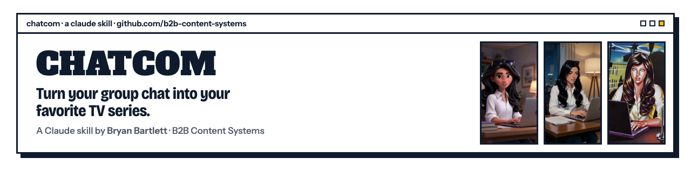

<picture>
  <source media="(prefers-color-scheme: dark)" srcset=".github/assets/header-chatcom-dark.png">
  
</picture>

[](https://b2b-content-systems.github.io/chatcom/)


**Turn your group chat into your favorite TV series.** Drop in your group chat. Get back an episode starring your friends, in the style of the show you love.

<p align="center"></p>

<p align="center"><a href="https://b2b-content-systems.github.io/chatcom/"><b>Watch the trailer and a full episode →</b></a></p>

## How it works

1. **Export your group chat.** Use the export button your messaging app already has (WhatsApp first).
2. **Pick your show.** Sitcom, anime, 80s cartoon, true crime. Your friends get cast from how they actually text.
3. **Watch it together.** The episode drops back into the chat. Next week, a new one. It remembers every running joke, so episode nine can call back to episode two.

## Pick your show

| The show | Looks like | Status |
|---|---|---|
| The sitcom | 3D feature, family-film warm | sample episode |
| The anime | City-pop, bright and flat | full sample episode |
| The 80s cartoon | Glossy airbrush, Saturday morning | sample episode |
| The true-crime doc | Grainy documentary | preview |
| The video-game cutscene | PS1-era 3D | preview |
| The family FaceTime | Video-call grid | preview |
| The 2006 flip-phone | Low-res phone camera | preview |
| The reality show | Phone snapshots | preview |

## Install (Claude Code)

```
/plugin marketplace add b2b-content-systems/skills
/plugin install chatcom@b2b-content-systems
```

Then drop in your export and ask: `make our group chat a show: tulum.zip`.

> **Status: v0.1 is in development.** The commands above are the release path; watch this repo to get it the day it ships. The sample episodes on the site were made with the same pipeline.

**Build progress (v0.1):** the open schemas, the WhatsApp parser (iOS and Android, 8 locale formats, tested), the episode window and the writer (Claude Code session, or Claude with a Gemini fallback) are in the repo. Casting and the video render are next. Today `chatcom episode` stops after the writer with the episode's `beats.json`.

To try the engine as it stands: `pipx install git+https://github.com/b2b-content-systems/chatcom`, then `chatcom new <export>` and `chatcom episode <show> --dry-run`. Adapters for other chat apps: see [CONTRIBUTING-adapters.md](CONTRIBUTING-adapters.md).

Planned commands for the CLI (`pipx install chatcom`):

```
chatcom demo                 render the bundled demo show, no keys needed
chatcom new <export>         create a show from a WhatsApp export and cast it
chatcom episode <show>       make this week's episode
```

## Share it

The trailer in every format (9:16, 1:1, 16:9) and four languages, posts ready to paste, alt text, images and a "Made with CHATCOM" badge: **[the share kit](https://b2b-content-systems.github.io/chatcom/share/)**. Please credit: *CHATCOM, a free Claude skill by Bryan Bartlett*.

## Your chat stays yours

CHATCOM runs on your own computer with your own API keys. Before the first model call it prints exactly what goes where: in skill mode, chat text goes to the model your Claude Code session uses, and reference photos and image prompts go to Google (Gemini). There is no CHATCOM server.

---

Made by **[Bryan Bartlett](https://bryanbartlett.com)**, B2B Content Systems, Boston, MA. A Claude skill from [github.com/b2b-content-systems](https://github.com/b2b-content-systems). MIT licence. Every show, person and chat in the samples is fictional.
